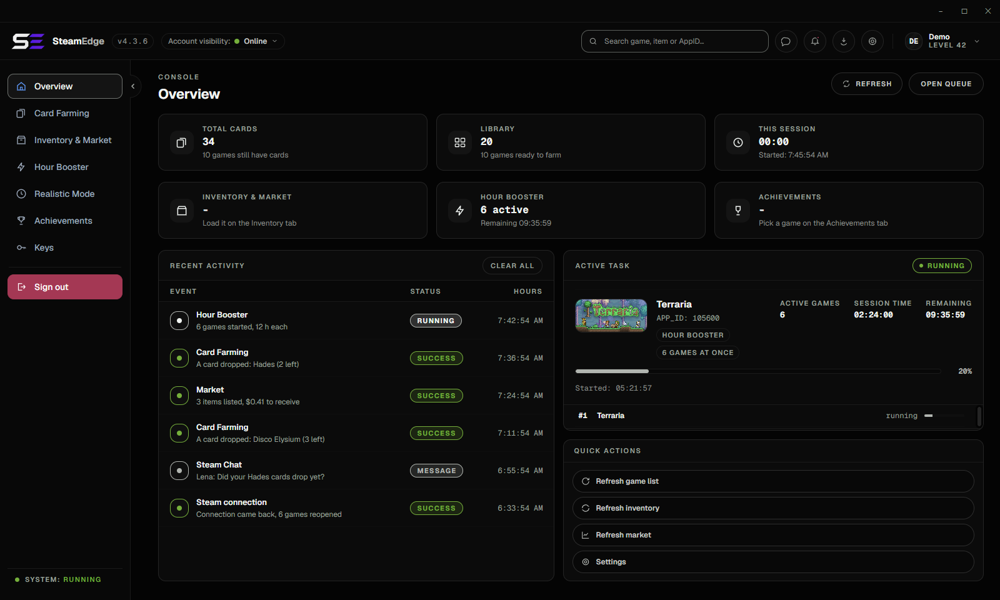
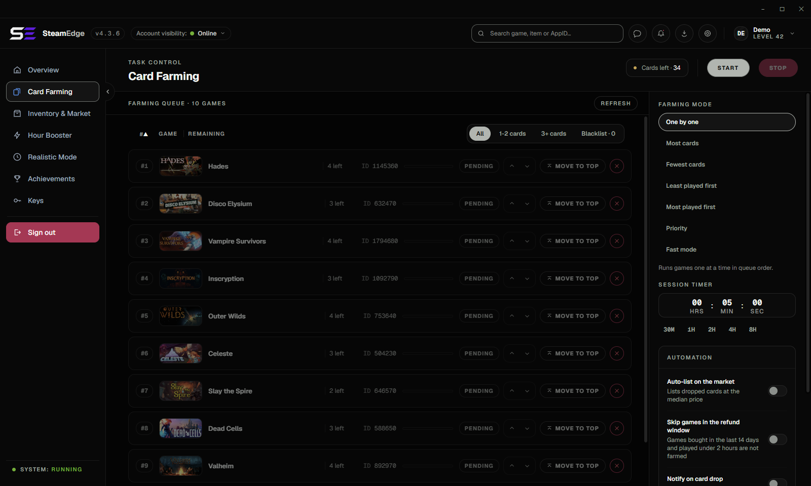
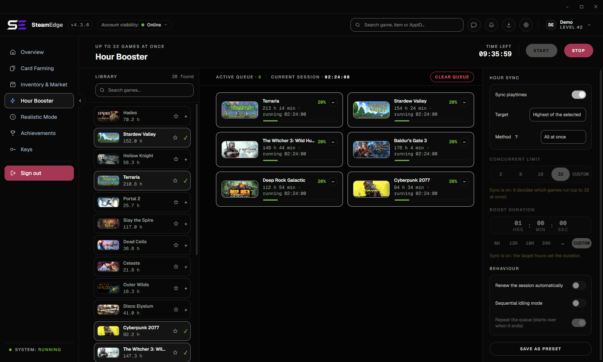
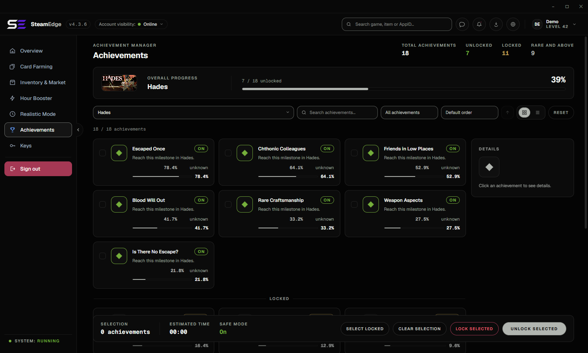
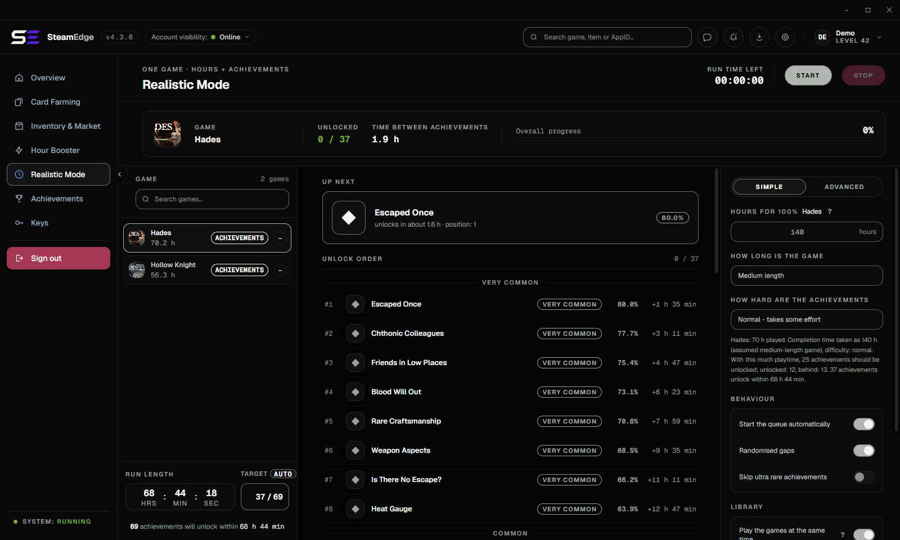
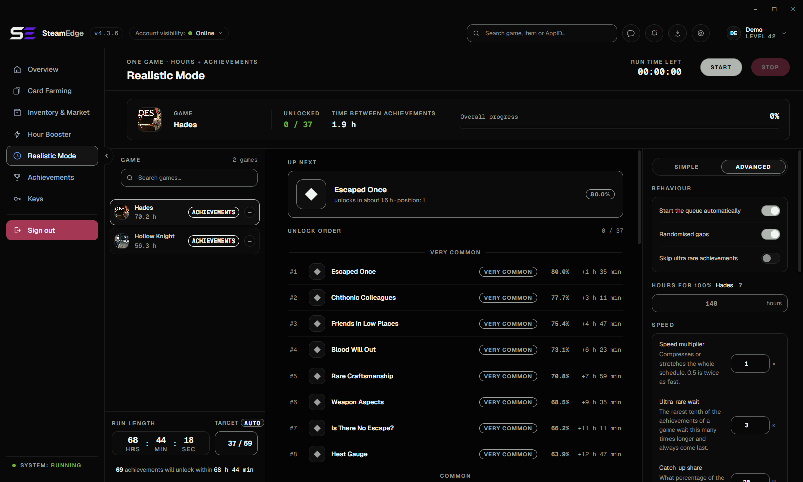
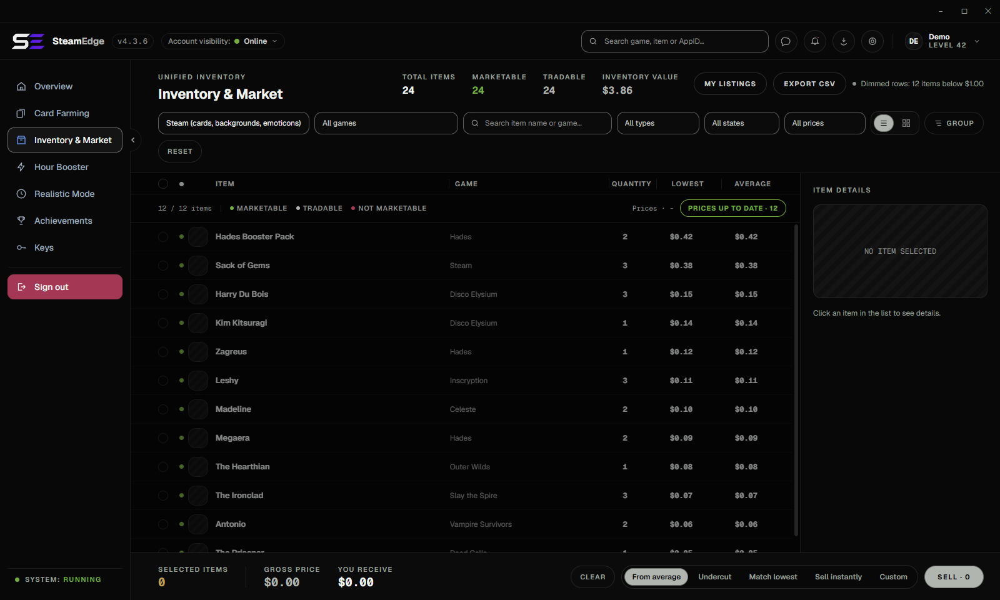
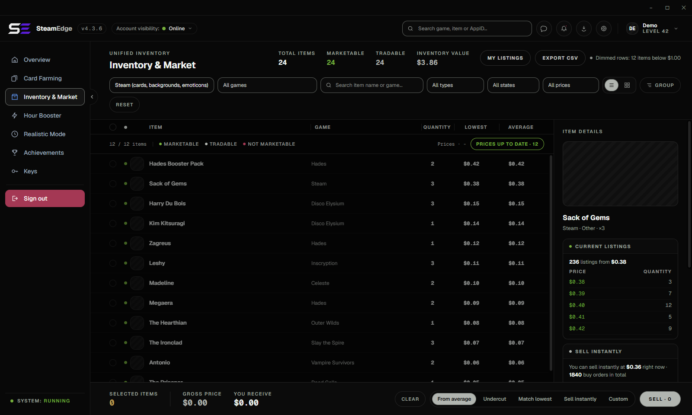
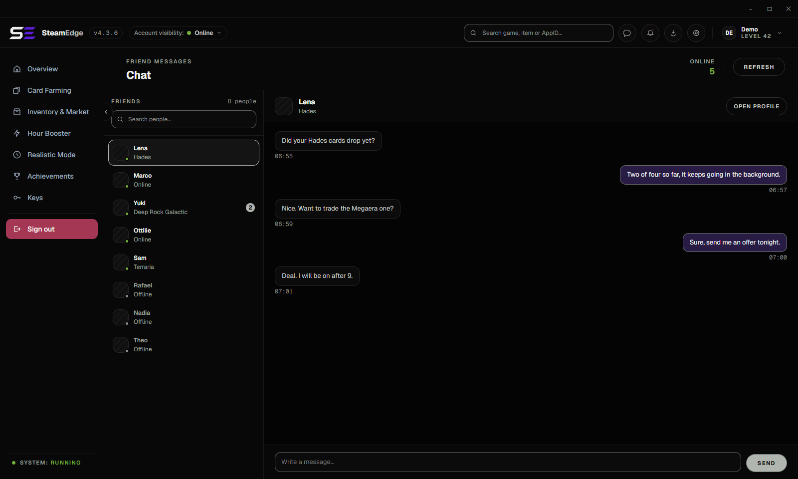
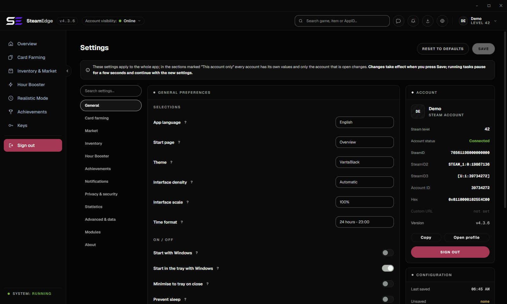

# SteamEdge

**Consigue cromos de Steam, acumula horas de juego y gestiona logros sin abrir nunca el cliente de Steam.**

[English](../../README.md) · [Türkçe](./README_TR.md) · **Español** · [简体中文](./README_ZH.md) · [Русский](./README_RU.md)

[Instalación](#-instalación) · [Funciones](./FEATURES_ES.md) · [Uso](#-inicio-rápido) · [Guía](./TUTORIAL_ES.md) · [Cambios](../../CHANGELOG.md)

<a href="./TUTORIAL_ES.md">
  <picture>
    <source media="(prefers-color-scheme: dark)" srcset="../../assets/btn-tutorial-dark.svg">
    
  </picture>
</a>

---

## 🔐 Seguridad y tu inicio de sesión de Steam

> [!WARNING]
> **SteamEdge puede actuar sobre tu cuenta de Steam: farmear cromos, subir horas, desbloquear logros y poner objetos a la venta en el mercado. Aquí está exactamente qué hace con tu inicio de sesión, dónde lo guarda y qué envía por la red, para que decidas si te sientes cómodo usándolo.**

**En breve:** tu contraseña nunca se escribe en disco, la aplicación solo habla con Steam, sus servidores de imágenes y la lista pública de versiones de GitHub, y no hay telemetría, ni analítica, ni ningún servidor mío. Qué guarda, dónde y cómo comprobarlo tú mismo está en [Privacidad y seguridad](./PRIVACY_ES.md).

---

## ✨ Lo esencial

- **Farmeo de cromos** - Ejecuta tus juegos como "jugando" para que caigan los cromos.
- **Impulsor de horas** - Mantiene hasta 32 juegos abiertos a la vez, con sincronización opcional que iguala las horas totales de una selección.
- **Gestor de logros** - Lee el estado real de bloqueo y desbloqueo directamente del protocolo de Steam, y luego desbloquea o rebloquea en lote.
- **Modo realista** - Desbloquea los logros de un juego del más común al más raro, repartidos en el tiempo que necesitaría un jugador de verdad, para que el perfil parezca realmente jugado. Los juegos de la cola pueden ir a la vez, de cinco en cinco.
- **Inventario y mercado** - Historial real de ventas, libro de órdenes, precios medios en lote y venta, todo en la moneda de tu cartera.
- **Claves de producto** - Pega una lista de claves y se canjean en segundo plano, una a una.
- **Varias cuentas** - Varias cuentas conectadas a la vez, cada una farmeando en segundo plano, intercambiables sin perder el progreso.
- **Sin cliente de Steam** - Habla el protocolo de red propio de Steam.
- **Setup o portátil** - Instálalo con el Setup o extrae el archivo y ejecútalo. En ambos casos tus datos quedan junto al ejecutable, y **Actualizar ahora** trae la versión siguiente.

**[Ver todas las funciones →](./FEATURES_ES.md)**

---

## 📸 Capturas

| | |
|:-:|:-:|
|  Farmeo de cromos |  Subida de horas |
|  Logros |  Modo realista |
|  Modo realista, avanzado |  Inventario y mercado |
|  Mercado, libro de órdenes |  Chat de Steam |
|  Ajustes |  |

---

## 📦 Instalación

### Requisitos

| | |
|---|---|
| Sistema operativo | Windows 10 o superior, 64 bits |
| Cuenta de Steam | Con Steam Guard configurado, móvil o correo |
| Espacio en disco | Unos 300 MB extraído o instalado |
| Cliente de Steam | No hace falta, y no se usa |

### Instalar

Dos formas, el mismo programa:

**Instalado.** Descarga `SteamEdge-Setup-v<versión>.exe` desde la [página de versiones](https://github.com/Miabeyefendi/SteamEdge/releases/latest). El Setup muestra la licencia y pregunta dónde instalar (Program Files por defecto, vale cualquier carpeta) y en qué idioma se abre SteamEdge. Tus ajustes y cuentas viven en las carpetas `settings` y `cache` junto al ejecutable, igual que en la copia portátil, así que puedes pasarlos de una a otra copiando esas carpetas. Las actualizaciones nunca las tocan.

**Portátil.** Descarga `SteamEdge-v<versión>-win-x64.rar` (o el `.zip`), extráelo donde quieras y ejecuta `SteamEdge.exe`. No se instala nada y no se escribe nada fuera de esa carpeta.

Para actualizar, pulsa **Actualizar ahora** en la ventana de actualización: la app descarga la nueva versión de la publicación de GitHub de este proyecto, comprueba su SHA-256 y la instala (una copia instalada ejecuta el nuevo Setup, una portátil sustituye sus archivos en su sitio; los ajustes se conservan). Las copias anteriores a 3.0.0 no pueden actualizarse solas: extrae la nueva versión en una carpeta nueva y vacía y copia en ella la carpeta `settings/` de la anterior.

El SHA-256 de cada archivo está en el [README en inglés](../../README.md#install) y en la nota de la versión. Compruébalo en PowerShell con `Get-FileHash .\<nombre del archivo>`.

---

## 🚀 Inicio rápido

En el primer arranque aparece la pantalla de inicio de sesión. Escanea el código QR con la aplicación móvil de Steam, o cambia a la pestaña de contraseña e introduce tus credenciales y un código de Steam Guard. No se guarda nada salvo un token de sesión en `settings/`, junto al ejecutable.

Una vez dentro, el Resumen muestra qué está en marcha y qué está disponible. Abre **Farmeo de cromos**, actualiza la lista, elige un modo y pulsa Iniciar. Lo demás puede esperar a que leas la [guía](./TUTORIAL_ES.md).

---

## 📖 Documentación

- [**Funciones**](./FEATURES_ES.md) - todo lo que hace la aplicación
- [**Guía**](./TUTORIAL_ES.md) - todas las funciones y ajustes, explicados por completo
- [**Ajustes**](./SETTINGS_ES.md) - dónde viven los ajustes y las claves que conviene conocer
- [**Privacidad y seguridad**](./PRIVACY_ES.md) - qué hace con tu inicio de sesión y qué sale por la red
- [**Preguntas frecuentes**](./FAQ_ES.md) - bloqueos, precios, logros que no se desbloquean, actualizaciones
- [**Hoja de ruta**](./ROADMAP_ES.md) - qué está hecho y qué sigue
- [**Cambios**](../../CHANGELOG.md) - qué cambió en cada versión
- [**Para desarrolladores**](../DEVELOPERS.md) - estructura del código, pruebas, costumbres (en inglés)
- [**Contribuir**](../../CONTRIBUTING.md) - cómo enviar un cambio
- [**Informes de seguridad**](../../SECURITY.md) - cómo informar de una vulnerabilidad en privado

---

## 🤝 Contribuir

Las contribuciones son bienvenidas. Lee antes [CONTRIBUTING.md](../../CONTRIBUTING.md) y
[CODE_OF_CONDUCT.md](../../CODE_OF_CONDUCT.md). Al contribuir aceptas licenciar tu
trabajo bajo la AGPL-3.0.

<a href="https://github.com/Miabeyefendi/SteamEdge/issues/new?template=bug_report.yml">
  <picture>
    <source media="(prefers-color-scheme: dark)" srcset="../../assets/btn-report-bug-dark.svg">
    
  </picture>
</a>
<a href="https://github.com/Miabeyefendi/SteamEdge/stargazers">
  <picture>
    <source media="(prefers-color-scheme: dark)" srcset="../../assets/btn-star-dark.svg">
    
  </picture>
</a>

---

## 📜 Licencia

Este proyecto se publica bajo la **Licencia Pública General Affero de GNU v3.0
(AGPL-3.0)**, junto con los términos complementarios del archivo
[NOTICE](../../NOTICE). En resumen:

- Puedes usar, estudiar, modificar, redistribuir e incluso ganar dinero con este
  software de forma gratuita, **siempre que** mantengas el código fuente completo
  disponible bajo la AGPL-3.0, incluido cualquier uso alojado, SaaS o en red
  (AGPL, sección 13), y conserves la atribución al autor que figura abajo.
- Para usar este trabajo en un producto cerrado o propietario, o ejecutarlo como
  un SaaS cerrado, necesitas una **licencia comercial escrita aparte**, que puede
  incluir regalías o reparto de ingresos. Consulta [NOTICE](../../NOTICE), sección 8,
  y ponte en contacto conmigo.

### Atribución (obligatoria)

Según la sección 7(b) de la AGPL-3.0, la siguiente atribución debe conservarse,
visible y sin modificar, en toda copia, bifurcación o despliegue de este proyecto:

> **Miabeyefendi (Mustafa Ihsan Albayrak)** - https://github.com/Miabeyefendi

### Descargo de responsabilidad

Este software se entrega "tal cual", sin garantía de ningún tipo. Lo ejecutas
enteramente bajo tu propio riesgo y eres el único responsable de tu uso, incluido
el cumplimiento de las condiciones de servicio de cualquier plataforma de terceros
con la que interactúe. Valve y Steam no están afiliados al autor ni lo respaldan;
sus nombres y marcas pertenecen a sus respectivos propietarios. El autor no acepta
responsabilidad alguna por baneos de cuenta, pérdida de datos ni ningún otro daño,
en la máxima medida permitida por la ley aplicable. Los términos completos están
en los archivos [LICENSE](../../LICENSE) y [NOTICE](../../NOTICE).

---

## 📬 Contacto

- GitHub: [@miabeyefendi](https://github.com/Miabeyefendi)
- Para licencias comerciales o reparto de ingresos, contáctame a través de mi
  perfil de GitHub.
