<div align="center">


# SteamEdge

**Собирайте коллекционные карточки Steam, накапливайте время в играх и управляйте достижениями, ни разу не открыв клиент Steam.**

[](../../LICENSE)
[](https://github.com/Miabeyefendi/SteamEdge/releases/latest)
[](#-установка)
[](#)
[](https://github.com/Miabeyefendi)

[English](../../README.md) · [Türkçe](./README_TR.md) · [Español](./README_ES.md) · [简体中文](./README_ZH.md) · **Русский**

[Установка](#-установка) · [Возможности](#-главное) · [Использование](#-быстрый-старт) · [Руководство](./TUTORIAL_RU.md) · [Изменения](../../CHANGELOG.md)

<a href="https://github.com/Miabeyefendi/SteamEdge/releases/latest">
  
</a>
<a href="./TUTORIAL_RU.md">
  <picture>
    <source media="(prefers-color-scheme: dark)" srcset="../../assets/btn-tutorial-dark.svg">
    
  </picture>
</a>

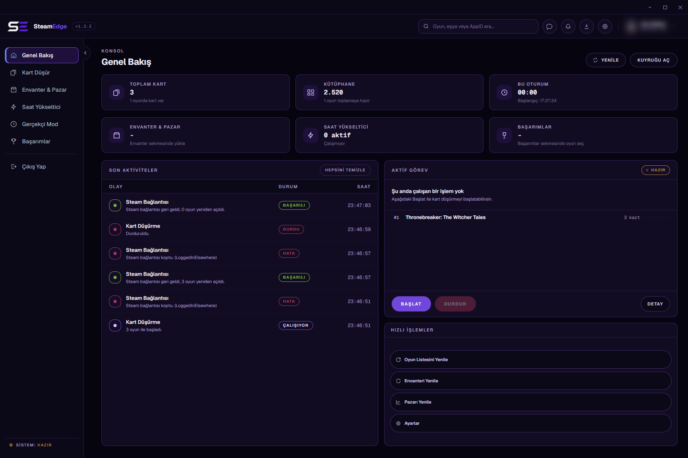

</div>

---

> **Примечание.** Документация переведена на русский язык, интерфейс приложения пока нет.
> Русская локализация интерфейса стоит в плане развития.

---

<div align="center">


</div>

## 🔐 Безопасность и ваш вход в Steam

> [!WARNING]
> **SteamEdge может действовать от имени вашего аккаунта Steam: собирать карточки, накручивать часы, открывать достижения и выставлять предметы на торговую площадку. Ниже точно описано, что он делает с вашим входом, где его хранит и что отправляет по сети, чтобы вы сами решили, комфортно ли вам им пользоваться.**

| Что | Что происходит |
|---|---|
| **Пароль** | Вводится на экране входа и сразу передаётся службе входа самого Steam по HTTPS. В памяти он находится только на время этого вызова. **На диск он никогда не записывается** и в журнал не попадает. |
| **Коды Steam Guard** | Один раз отправляются в Steam и отбрасываются. Не хранятся. У приложения нет секретов вашего аутентификатора (старая функция maFile удалена в 1.1.9), поэтому оно не может подтверждать мобильные запросы за вас. |
| **Токен сессии** | После входа Steam выдаёт приложению токен обновления, чтобы пароль не запрашивали снова. Это не ваш пароль. Он хранится в `settings/session.json` и `settings/accounts.json` рядом с exe. **По умолчанию это обычный текст.** Включите *Настройки > Приватность и безопасность > Шифровать токены входа*, и токен будет запечатан Windows DPAPI: прочитать его сможет только ваш пользователь Windows на этом ПК. Веб-cookie живут только в памяти. |
| **Вход через cookie (запасной путь)** | Если вы входите через cookie вместо обычного входа, `settings/web-session.json` хранит эти cookie открытым текстом до выхода из аккаунта. |
| **Файл журнала** | `cache/steamedge.log` хранит события, но не пароли, токены и cookie. |
| **Экспорт** | Экспорт настроек не включает токены, адреса прокси (с паролями) и родительский PIN. |

**Что уходит в сеть**

- **Сам Steam**: те же соединения, что у клиента Steam (вход, чат, статус «играет»), через библиотеки `steam-user` и `steam-session`.
- **`steamcommunity.com`**: инвентарь, торговая площадка, лоты и страницы достижений, с вашей сессией.
- **`api.steampowered.com`**: вызовы входа и сессии.
- **`*.steamstatic.com`**: изображения игр и собственный скрипт Steam для расчёта комиссии (работает в скрытом изолированном окне без доступа к Node).
- **`api.github.com`**: один раз при запуске и по кнопке обновления, чтобы прочитать публичный список релизов. Ничего о вас не отправляет и ничего не скачивает и не устанавливает.
- **Ваш собственный прокси**, только если вы указали его для аккаунта или для входа.
- Больше ничего. **Нет моего сервера, аналитики, телеметрии, отчётов о сбоях и рекламы.** Шрифты встроены, поэтому к серверам шрифтов тоже нет обращений.

**Продажи**: лоты попадают на торговую площадку Steam так же, как с сайта. При включённом мобильном аутентификаторе каждый лот ждёт вашего подтверждения в приложении Steam, а SteamEdge дать его не может. Приложение делает запросы с паузами (не реже чем раз в 1,5 секунды) и никогда не отправляет один и тот же предмет дважды.

**Как заперто окно приложения**: оно загружает только собственные файлы, не может открывать веб-страницы, а доступ к Node внутри выключен (изоляция контекста и политика безопасности содержимого).

**Как проверить это самому**: код открыт (AGPL-3.0), каждое изменение проверяется CodeQL, SHA-256 каждого файла релиза опубликован, а собрать приложение можно самому командой `npm run build`.

**Защитите себя**
- Никому не передавайте папку `settings/` (архивы, скриншоты, обращения в поддержку). В ней может быть ваш токен.
- Включите шифрование токенов (выше) и используйте *Выйти*, когда заканчиваете работу на ПК.
- Чтобы разорвать все сохранённые сессии, используйте функцию Steam «выйти на всех остальных устройствах» в настройках Steam Guard.

**Честные границы**: это личный проект одного человека, он сделан не Valve и не связан с ней, а автоматизация аккаунта может нарушать правила Steam. Используйте на свой риск.

---

## ✨ Главное

- **Фарм карточек** - Запускает ваши игры как «играет», чтобы падали коллекционные карточки. Семь режимов, один из которых учитывает, что на аккаунтах с ограничением Steam начинает выдавать карточки только после того, как игра наберёт определённое время, обычно два часа.
- **Накрутка часов** - Держит открытыми до 32 игр одновременно, с необязательной синхронизацией времени, которая подтягивает выбранные игры к одному итогу.
- **Менеджер достижений** - Читает настоящее состояние блокировки и разблокировки прямо из протокола Steam, затем открывает или возвращает их пакетом.
- **Реалистичный режим** - Держит одну игру открытой и открывает её достижения от самых частых к самым редким, распределяя их по всей сессии, чтобы профиль выглядел действительно отыгранным.
- **Инвентарь и торговая площадка** - Реальная история продаж, стакан заявок, средние цены пакетом и продажа, всё в валюте вашего кошелька. Цена лота считается собственной формулой комиссии Steam, а массовая продажа останавливается и сообщает, когда достигнут лимит Steam для аккаунта, или делит продажу на партии. Активные лоты можно снять, а бустер-паки открыть на той же странице. Переключатель открывает предметы других игр (Counter-Strike 2, Dota 2 и другие) с теми же инструментами.
- **Ключи продуктов** - Вставьте список ключей, и они активируются в фоне по одному. Когда достигнут часовой лимит Steam, очередь ждёт и продолжает сама. Ключ, который у аккаунта уже есть, можно пробовать на других ваших аккаунтах, а бесплатная игра добавляется по ссылке на её страницу в магазине.
- **Чат** - Список друзей, переписка и отправка сообщений по тому же сетевому протоколу. Счётчик непрочитанных виден на вкладке, так что во время работы очереди ничего не теряется.
- **Несколько аккаунтов** - Несколько аккаунтов подключены одновременно, каждый фармит в фоне, переключение не теряет прогресс. Статистика ведётся для каждого аккаунта.
- **Расписание, прокси и защита токенов** - Сбор карточек и Реалистичный режим могут запускаться сами в заданном интервале, у каждого аккаунта может быть свой HTTP- или SOCKS5-прокси (у входа он тоже есть), а сохранённые токены входа можно шифровать с помощью Windows DPAPI.
- **Списки и фильтры** - Постоянные чёрный и белый списки для сбора карточек, фильтр, пропускающий игры в периоде возврата, избранные игры в начале списков и экспорт инвентаря в CSV.
- **Темы и языки** - Тёмная, полночная фиолетовая и белая темы, включая экран входа. Турецкий, английский, немецкий, испанский, традиционный китайский и русский. Новые установки запускаются на английском.
- **Подстраивается под экран** - Вёрстка гибкая вплоть до 900 x 560: списки переносятся на вторую строку, а не уходят за край, боковое меню само закрывается в узком окне, а в низком окне интерфейс становится компактным. Окно открывается там, где его оставили, на экране, который всё ещё подключён. В окне меньше 900 x 560 вся страница масштабируется вместе с ним, вплоть до 675 x 420, и кнопки сохраняют форму.
- **Модульность** - Отключайте страницы, которыми не пользуетесь (карточки, часы, инвентарь, достижения, ключи, чат), а остальные расставляйте в своём порядке. Отключённая страница ничего не запрашивает у Steam. Лёгкий режим убирает анимации и размытие для слабых компьютеров, а автоматическая настройка выбирает его за вас. Малые функции (блок активности, звёздочки избранного, кнопки «Мои лоты» и CSV) и элементы верхней панели (поиск, уведомления, обновления) тоже можно отключить.
- **Продолжает с того же места** - Фарм карточек, накрутка часов или прогон реалистичного режима, шедшие в момент закрытия приложения, выключения ПК или сбоя, продолжаются с того же места, когда аккаунт снова подключится. Время, пока приложение не работало, не считается: накрутка, у которой оставалось три часа, снова имеет три часа.
- **Читаемость и клавиатура** - Масштаб интерфейса от 80 до 150 процентов (также Ctrl + / - / 0), тема высокой контрастности, следующая настройке контраста системы, текст с контрастом не ниже 4,5 : 1 и не мельче 11 пикселей, а также переключатели и боковое меню, работающие с клавиатуры и с программой чтения с экрана.
- **Без клиента Steam** - Работает по собственному сетевому протоколу Steam. Клиент никогда не запускается и не нужен.
- **Портативность** - Распакуйте и запустите. Без установщика, без реестра, всё лежит рядом с исполняемым файлом.

---

## 📸 Скриншоты

<div align="center">

| | |
|:-:|:-:|
| 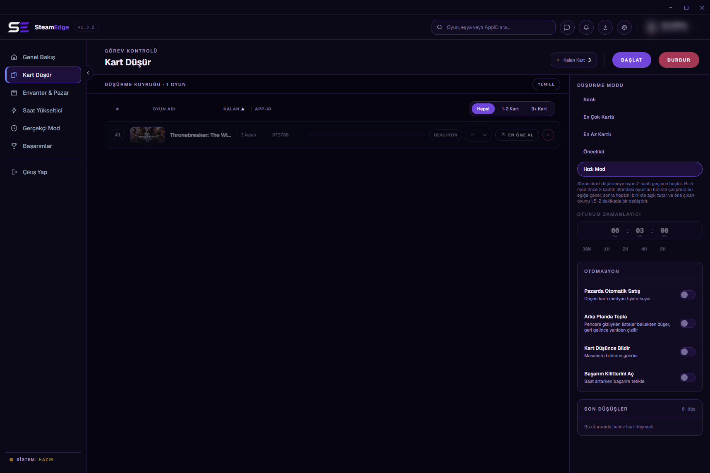<br><sub>Фарм карточек</sub> | 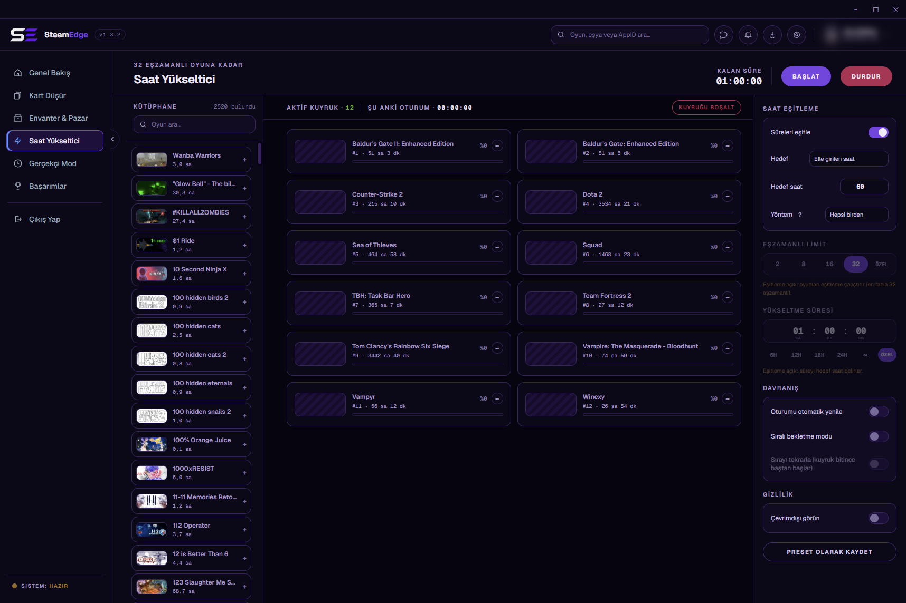<br><sub>Накрутка часов</sub> |
| 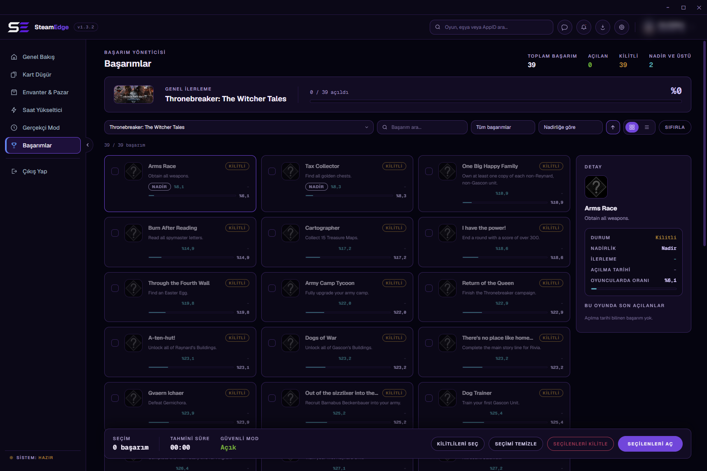<br><sub>Достижения</sub> | 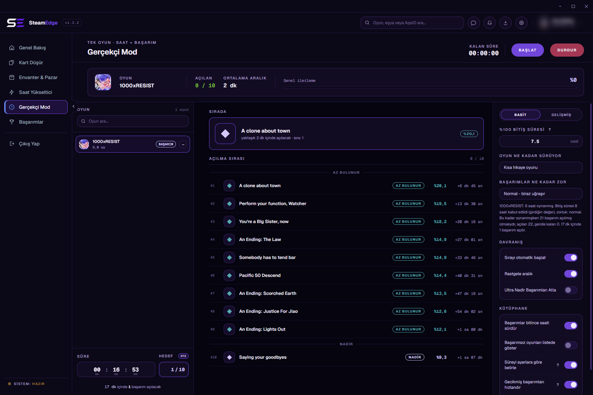<br><sub>Реалистичный режим</sub> |
| 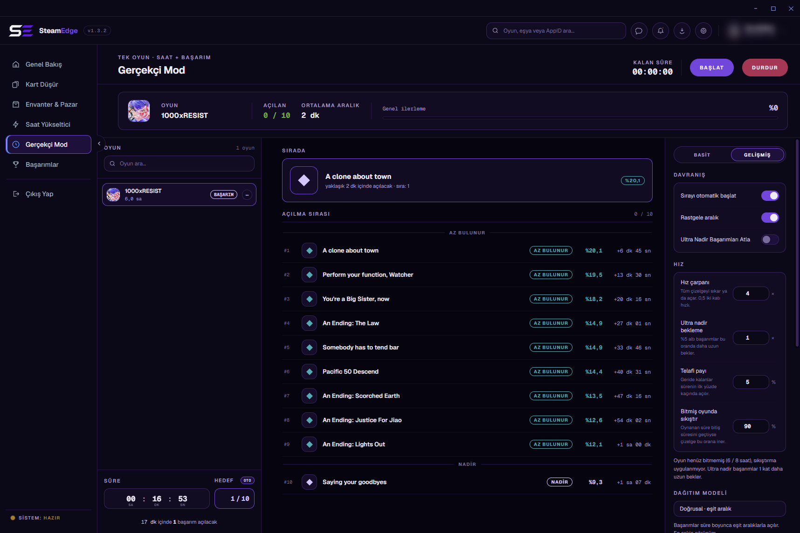<br><sub>Реалистичный режим, расширенный</sub> | 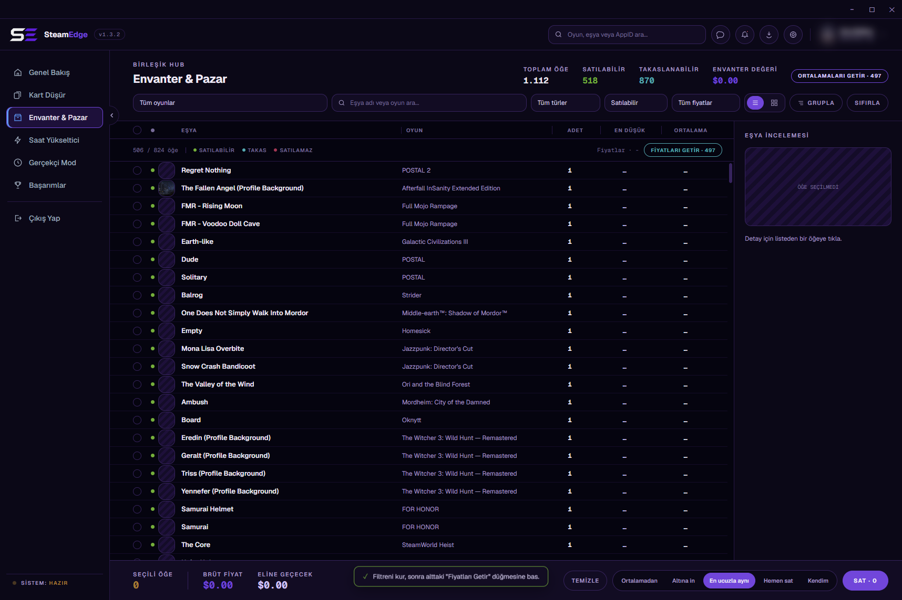<br><sub>Инвентарь и торговая площадка</sub> |
| 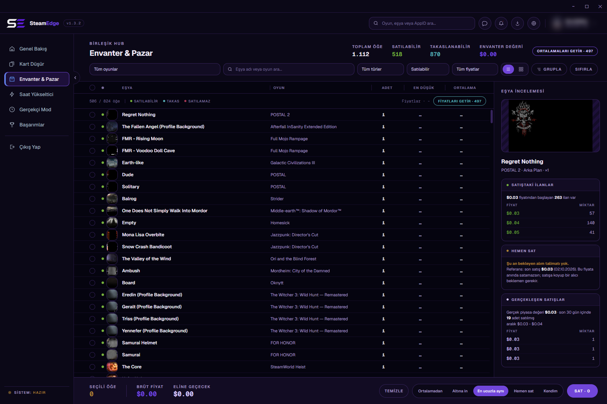<br><sub>Площадка, стакан заявок</sub> | 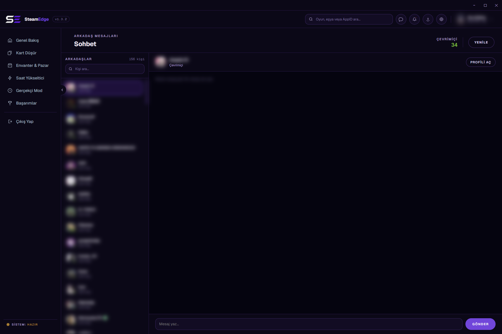<br><sub>Чат Steam</sub> |
| 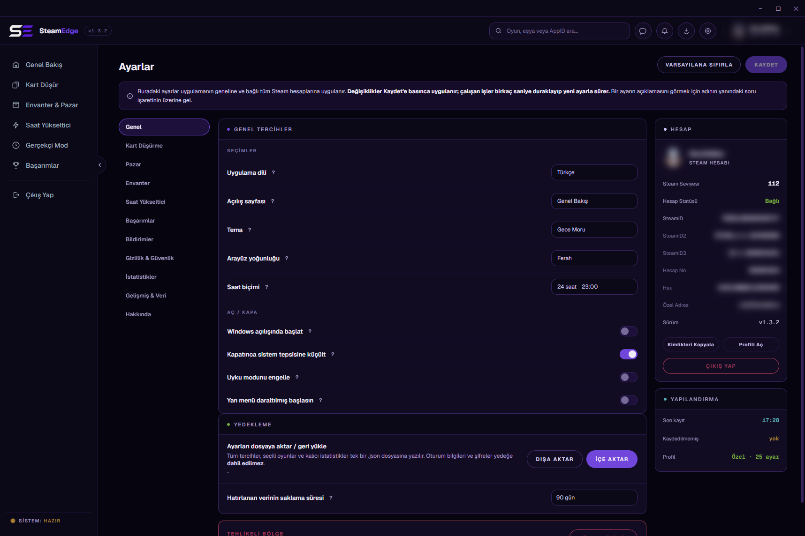<br><sub>Настройки</sub> |  |

**Темы: тёмная, полночный фиолетовый, белая (Настройки > Общие > Тема)**

| Тёмная | Полночный фиолетовый | Белая |
|---|---|---|
| 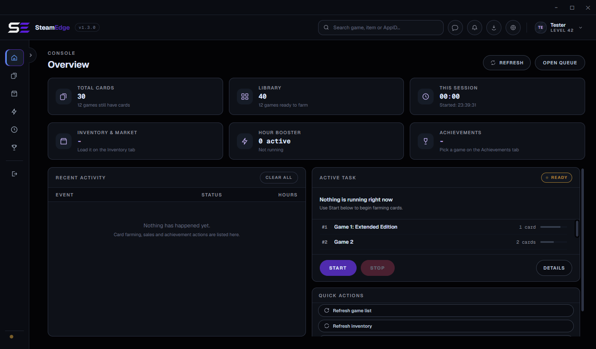 | 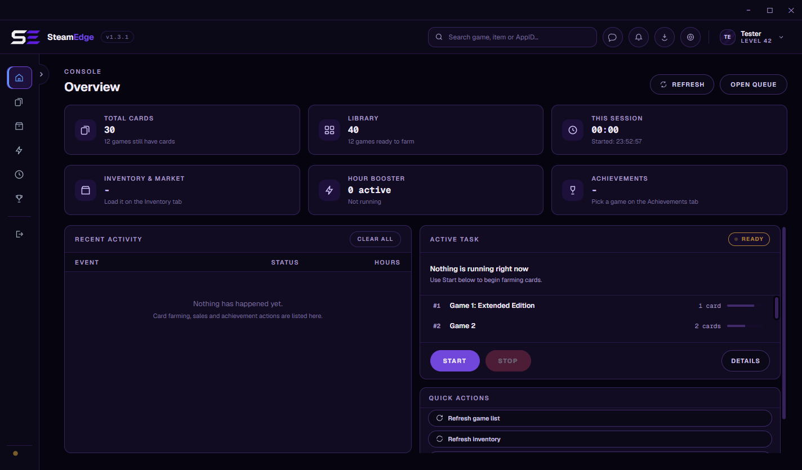 | 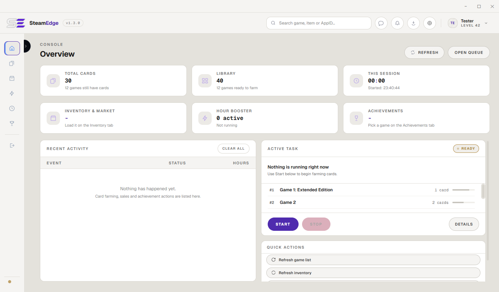 |
| 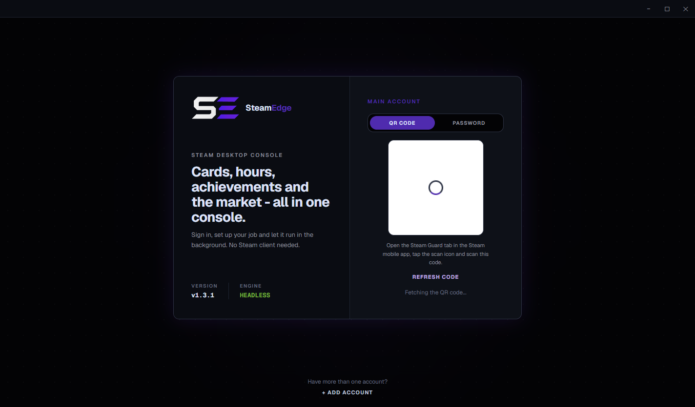 | 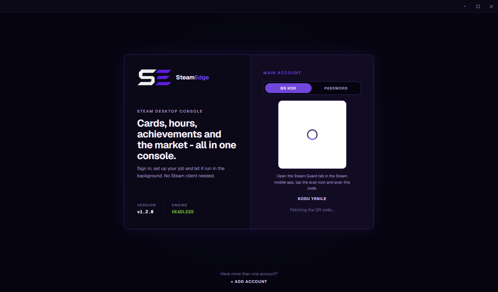 | 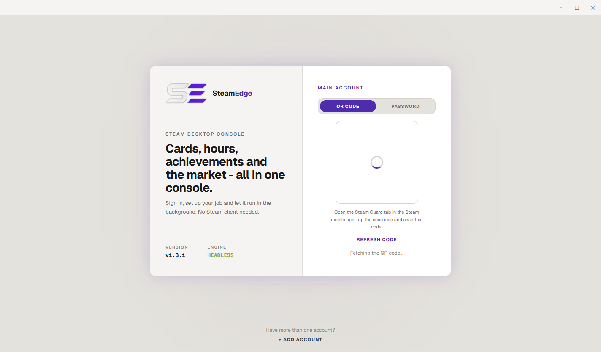 |

</div>

---

## 📦 Установка

### Требования

| | |
|---|---|
| Операционная система | Windows 10 или новее, 64 бита |
| Аккаунт Steam | С настроенным Steam Guard, мобильным или почтовым |
| Место на диске | Около 330 МБ в распакованном виде |
| Клиент Steam | Не требуется и не используется |

### Сделано на


### Установка

```bash
git clone https://github.com/Miabeyefendi/SteamEdge.git
cd SteamEdge
npm install
```

<details>
<summary><b>Установить из готового выпуска</b></summary>

1. Скачайте последний `.rar` со [страницы выпусков](https://github.com/Miabeyefendi/SteamEdge/releases/latest).
2. Распакуйте куда угодно. В свою папку, а не в `Program Files`.
3. Запустите `SteamEdge.exe`. Устанавливать нечего, за пределы этой папки ничего не пишется.
4. Для обновления распакуйте новую версию в пустую новую папку и скопируйте туда папку `settings/` из старой. Распаковка поверх старой папки при открытом приложении смешивает файлы двух версий.

</details>

---

## 🚀 Быстрый старт

```bash
npm start
```

При первом запуске появится экран входа. Отсканируйте QR-код мобильным приложением Steam или перейдите на вкладку с паролем и введите логин, пароль и код Steam Guard. Ничего не сохраняется, кроме токена сессии в папке `settings/` рядом с исполняемым файлом.

После входа «Обзор» показывает, что выполняется и что доступно. Откройте **Фарм карточек**, обновите список, выберите режим и нажмите «Старт». Остальное может подождать, пока вы не прочитаете [руководство](./TUTORIAL_RU.md).

---

## ⚙️ Настройка

Общие настройки лежат в `settings/settings.json` рядом с исполняемым файлом, данные по каждому аккаунту в `settings/accounts/<steamID>.json`. Почти всё это правится на странице «Настройки» в самом приложении и на страницах самих функций; трогать файлы вручную незачем. Изменения на странице «Настройки» применяются только после нажатия «Сохранить», а работающие задачи подхватывают их за несколько секунд.

> **Никогда не делитесь папкой `settings/`.** В ней токен сессии Steam, которого достаточно, чтобы пользоваться вашим аккаунтом.

| Ключ | По умолчанию | Что делает |
|---|---|---|
| `boostMaxGames` | `32` | Сколько игр накрутка часов держит открытыми одновременно |
| `boostSync` | `false` | Подтягивает выбранные игры к одному итоговому времени |
| `fetchAvgWithPrice` | `true` | Берёт среднюю цену продаж в том же проходе, что и цену |
| `pauseFarmOnBoost` | `false` | Приостанавливает фарм карточек, пока работает накрутка часов или реалистичный режим |
| `bulkSellLimit` | `50` | Массовая продажа делится на партии по столько предметов; `0` выставляет, пока Steam не остановит |
| `priceDropThreshold` | `10` | На сколько процентов ниже 24-часовой средней Steam цена считается упавшей |
| `reconnectPolicy` | `unlimited` | Переподключение при обрыве: `unlimited` (без ограничения), `10`, `3` или `off` (выкл.) |
| `sessionTimeout` | `never` | Закрывает все сессии после стольких минут бездействия; работающие задачи бездействием не считаются |
| `theme` | `dark` | Цветовая тема: `dark`, `midnight`, `white` |
| `language` | `en` | Язык интерфейса: `tr`, `en`, `de`, `es`, `zh`, `ru` |

[Справочник настроек](./TUTORIAL_RU.md#️-справочник-настроек) охватывает ключи, которые стоит знать; остальные соответствуют прочим элементам управления на странице «Настройки».

---

## 📖 Документация

- [**Руководство**](./TUTORIAL_RU.md) - каждая возможность и каждая настройка, полностью
- [**Изменения**](../../CHANGELOG.md) - что поменялось в каждом выпуске
- [**Участие**](../../CONTRIBUTING.md) - как прислать правку
- [**Безопасность**](../../SECURITY.md) - как приватно сообщить об уязвимости

---

## 🧭 План развития

- [x] Чат Steam: список друзей, переписка и отправка сообщений в приложении
- [x] Русский язык интерфейса, вровень с документацией
- [x] Реалистичный режим перестроен по макету
- [x] Очередь торговой площадки по предметам, цена и средняя вместе
- [x] Переведены все тексты, создаваемые во время работы, с формами множественного числа (1.3.0)
- [x] Темы: тёмная, полночная фиолетовая, белая (1.3.0)
- [x] Electron 41 (1.3.2)
- [x] Английский язык по умолчанию, остальной текст интерфейса переведён (1.3.3)
- [x] Весь код на английском: идентификаторы, комментарии, id элементов, каналы IPC, ключи настроек и имена файлов (1.4.0)
- [x] Гибкая вёрстка для маленьких экранов и окно, которое помнит своё место (1.4.9)
- [ ] Остальные страницы, перестроенные по макету, по одной на выпуск

Ничто из этого не обещание. Это личный проект, и список меняется вместе с моими приоритетами.

---

## ❓ Частые вопросы

<details>
<summary><b>Нужен ли запущенный клиент Steam?</b></summary>

Нет. SteamEdge напрямую говорит по собственному сетевому протоколу Steam. Клиент никогда не запускается, и от того, открыт он или нет, ничего не меняется.

</details>

<details>
<summary><b>Могут ли за это забанить аккаунт?</b></summary>

Держать игры запущенными и открывать достижения по протоколу делают очень многие инструменты, и Valve никогда публично не занимала по этому поводу позицию. Это не то же самое, что безопасность. Вы запускаете это на свой страх и риск. Прочитайте отказ от ответственности ниже, прежде чем решать.

</details>

<details>
<summary><b>Почему цены не переводятся в мою валюту?</b></summary>

Они уже в ней. Цены приходят из Steam в валюте кошелька вашего аккаунта и показываются ровно так, как пришли. Пересчёт означал бы выдуманный курс, а выдуманное число хуже, чем никакого.

</details>

<details>
<summary><b>Достижение не открывается. Почему?</b></summary>

Некоторые достижения пишет сервер игры, а не клиент, и Steam не позволяет ни одному клиенту их выставить. SteamEdge распознаёт такие по схеме и пропускает их, вместо того чтобы раз за разом получать отказ. Несколько игр вообще не хранят статистику по этому протоколу; тогда вы увидите `0 / N`, и сделать с этим нечего.

</details>

<details>
<summary><b>После обновления перестало работать. Что теперь?</b></summary>

Убедитесь, что новая версия распакована в пустую новую папку и скопирована только `settings/`; распаковка поверх старой папки смешивает файлы двух версий. Сначала посмотрите [раздел про неполадки](./TUTORIAL_RU.md#-устранение-неполадок) в руководстве, затем журнал `cache/steamedge.log`. Если всё ещё не работает, откройте отчёт об ошибке и приложите этот журнал.

</details>

---

## 🤝 Участие

Вклад приветствуется. Сначала прочитайте [CONTRIBUTING.md](../../CONTRIBUTING.md) и
[CODE_OF_CONDUCT.md](../../CODE_OF_CONDUCT.md). Присылая правку, вы соглашаетесь
лицензировать свою работу под AGPL-3.0.

<div align="center">
<a href="https://github.com/Miabeyefendi/SteamEdge/issues/new?template=bug_report.yml">
  <picture>
    <source media="(prefers-color-scheme: dark)" srcset="../../assets/btn-report-bug-dark.svg">
    
  </picture>
</a>
<a href="https://github.com/Miabeyefendi/SteamEdge/stargazers">
  <picture>
    <source media="(prefers-color-scheme: dark)" srcset="../../assets/btn-star-dark.svg">
    
  </picture>
</a>
</div>

---

## 🛡️ Безопасность

Нашли уязвимость? Не открывайте публичную задачу. Следуйте приватной процедуре
из [SECURITY.md](../../SECURITY.md).

---

## 📜 Лицензия

Проект распространяется под **GNU Affero General Public License v3.0
(AGPL-3.0)** вместе с дополнительными условиями из файла [NOTICE](../../NOTICE).
Вкратце:

- Вы можете бесплатно использовать, изучать, изменять, распространять и даже
  зарабатывать на этом программном обеспечении, **при условии** что полный
  исходный код остаётся доступен под AGPL-3.0, включая любое размещённое,
  SaaS или сетевое использование (AGPL, раздел 13), и что вы сохраняете
  указание авторства ниже.
- Чтобы использовать эту работу в закрытом или проприетарном продукте либо
  запускать её как закрытый SaaS, нужна **отдельная письменная коммерческая
  лицензия**, которая может включать отчисления или долю от дохода. Смотрите
  [NOTICE](../../NOTICE), раздел 8, и свяжитесь со мной.

### Указание авторства (обязательно)

Согласно разделу 7(b) AGPL-3.0 следующее указание должно сохраняться, видимым
и неизменённым, в любой копии, форке или развёртывании этого проекта:

> **Miabeyefendi (Mustafa Ihsan Albayrak)** - https://github.com/Miabeyefendi

### Отказ от ответственности

Программное обеспечение предоставляется «как есть», без каких-либо гарантий.
Вы запускаете его исключительно на свой страх и риск и несёте единоличную
ответственность за своё использование, включая соблюдение условий обслуживания
любых сторонних платформ, с которыми оно взаимодействует. Valve и Steam не
связаны с автором и не поддерживают проект; их названия и товарные знаки
принадлежат их владельцам. Автор не несёт ответственности за блокировки
аккаунтов, потерю данных и любой иной ущерб в максимальной степени, допустимой
применимым законодательством. Полные условия в файлах [LICENSE](../../LICENSE) и
[NOTICE](../../NOTICE).

---

## 📬 Контакты

- GitHub: [@miabeyefendi](https://github.com/Miabeyefendi)
- По вопросам коммерческого лицензирования или разделения дохода пишите через
  мой профиль на GitHub.
