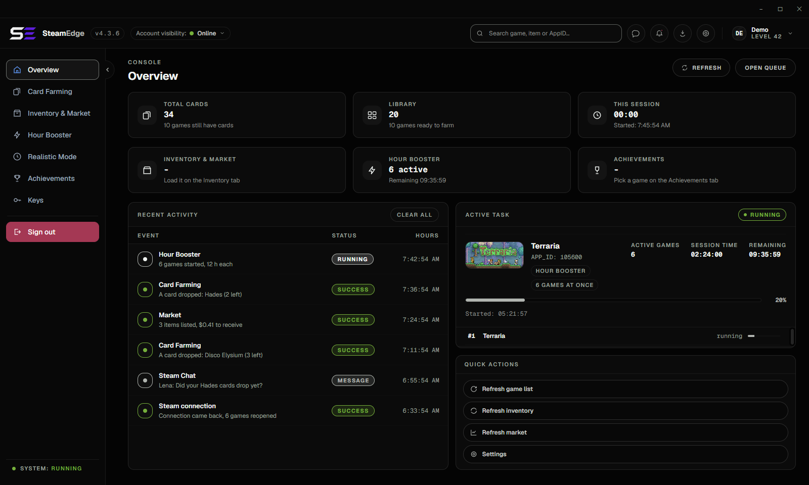
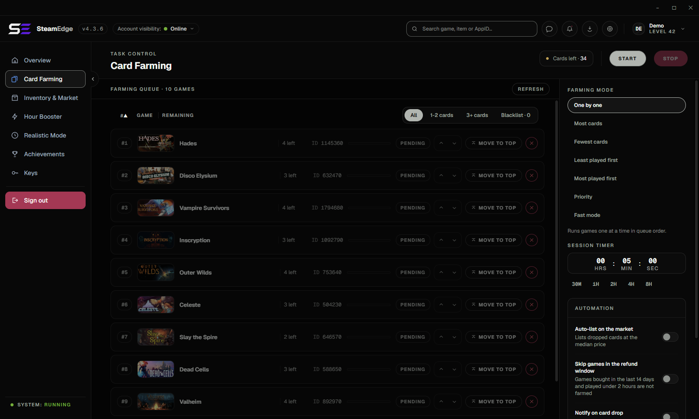
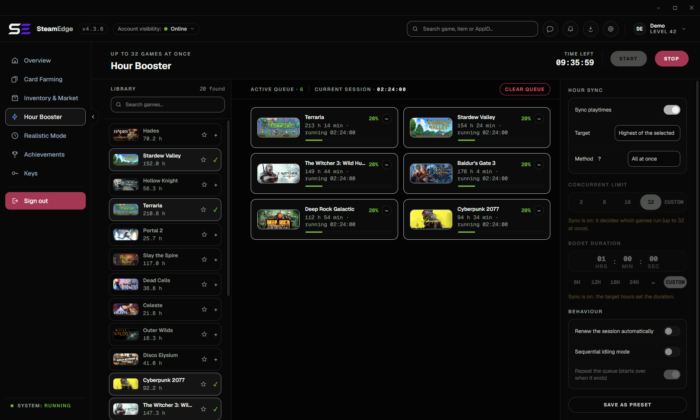
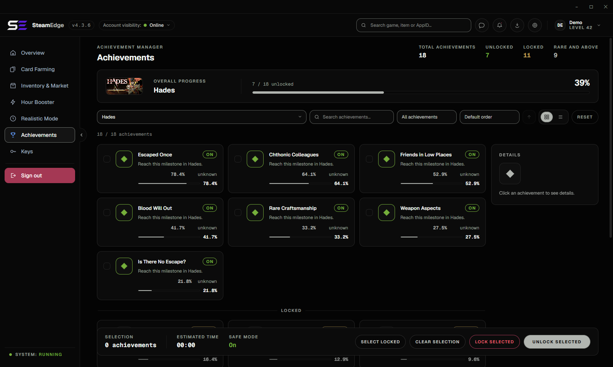
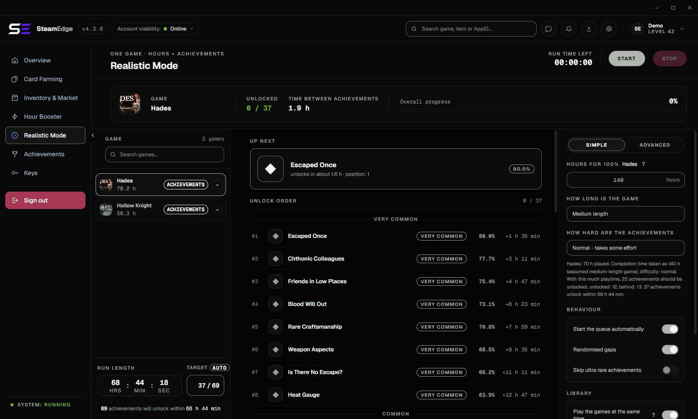
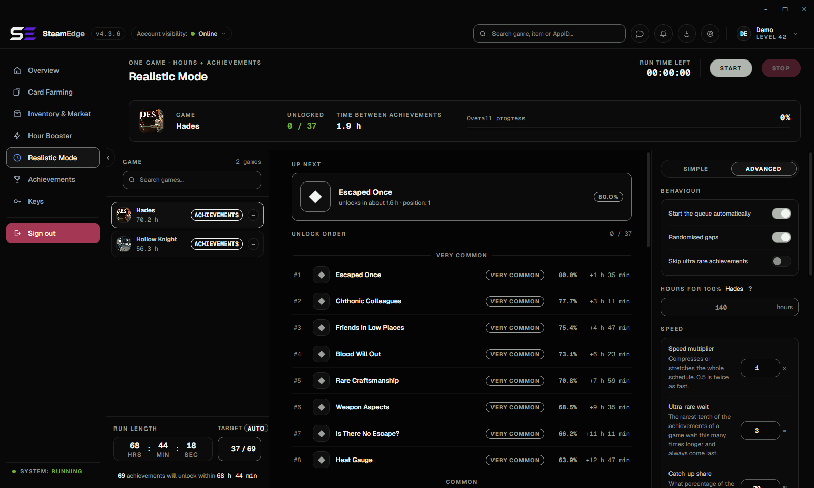
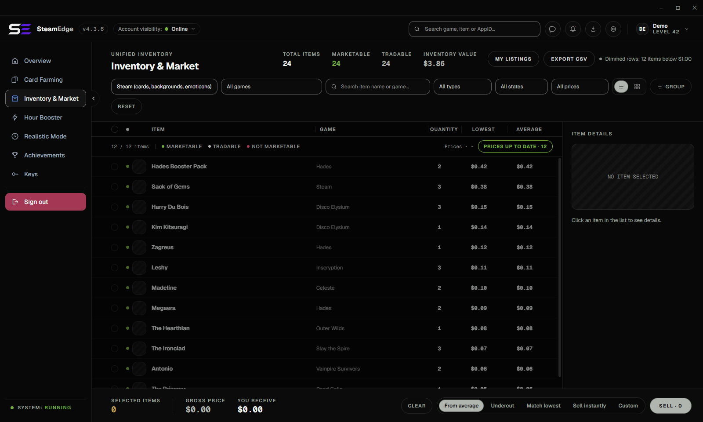
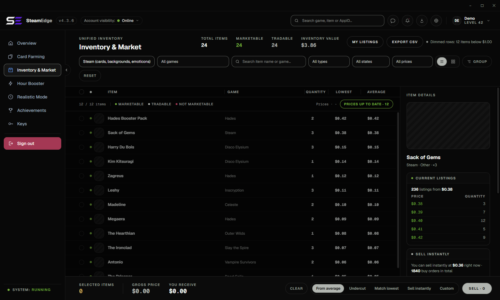
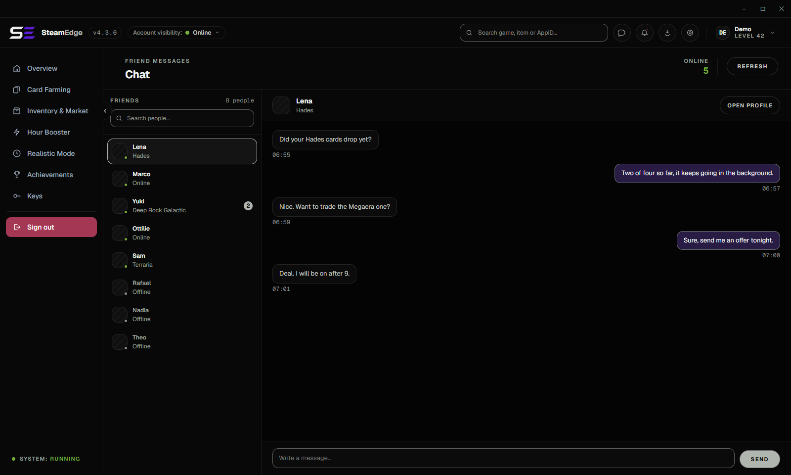
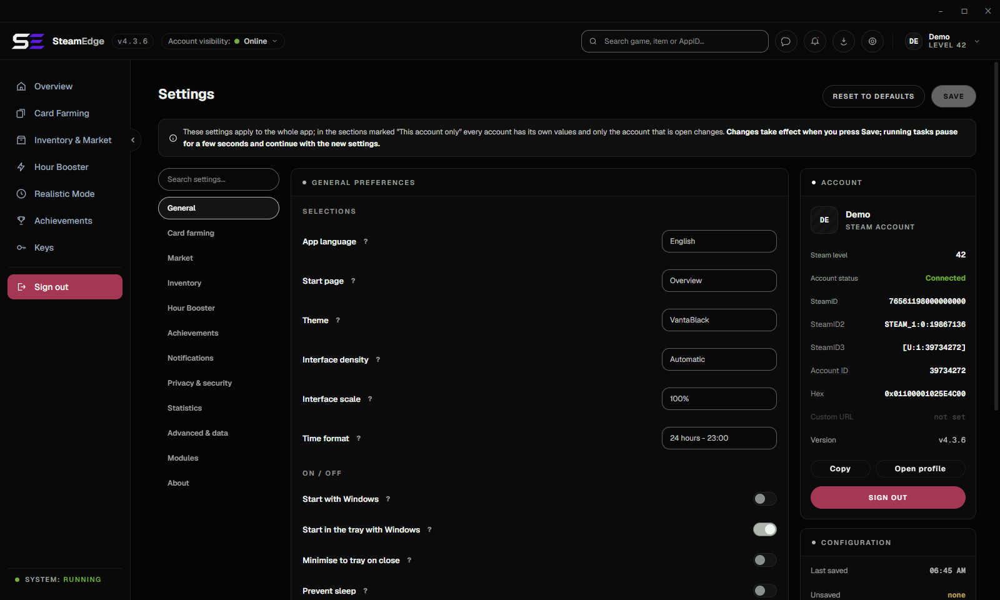

# SteamEdge

**Steam istemcisini hiç açmadan ticari kart topla, oynanma süresi biriktir, başarımlarını yönet.**

[English](../../README.md) · **Türkçe** · [Español](./README_ES.md) · [简体中文](./README_ZH.md) · [Русский](./README_RU.md)

[Kurulum](#-kurulum) · [Özellikler](./FEATURES_TR.md) · [Kullanım](#-hızlı-başlangıç) · [Rehber](./TUTORIAL_TR.md) · [Sürüm notları](../../CHANGELOG.md)

<a href="./TUTORIAL_TR.md">
  <picture>
    <source media="(prefers-color-scheme: dark)" srcset="../../assets/btn-tutorial-dark.svg">
    
  </picture>
</a>

---

## 🔐 Güvenlik ve Steam girişin

> [!WARNING]
> **SteamEdge Steam hesabın adına işlem yapabilir: kart toplar, saat yükseltir, başarım açar, pazarda eşya satar. Aşağıda girişinle tam olarak ne yaptığını, nerede sakladığını ve ağa ne gönderdiğini yazdım; rahat edip etmeyeceğine sen karar ver.**

**Kısaca:** parolan hiçbir zaman diske yazılmaz, uygulama yalnızca Steam'e, görsel sunucularına ve GitHub'ın herkese açık sürüm listesine bağlanır; telemetri, analiz ve benim bir sunucum yoktur. Neyi nerede sakladığı ve bunu kendin nasıl denetleyeceğin [Gizlilik ve güvenlik](./PRIVACY_TR.md) sayfasında.

---

## ✨ Öne çıkanlar

- **Kart düşürme** - Oyunlarını "oynanıyor" gösterir, ticari kartlar düşer.
- **Saat yükseltici** - Aynı anda 32 oyuna kadar açık tutar; istersen seçili oyunları aynı toplam süreye çeker.
- **Başarım yöneticisi** - Kilitli ve açık durumu doğrudan Steam protokolünden okur, toplu açar ya da yeniden kilitler.
- **Gerçekçi Mod** - Bir oyunun başarımlarını en yaygından en nadire doğru, gerçek bir oyuncunun ihtiyaç duyacağı süreye yayarak açar; profil gerçekten oynanmış gibi görünür. Sıradaki oyunlar beşer beşer aynı anda çalışabilir.
- **Envanter ve pazar** - Gerçek satış geçmişi, sipariş defteri, toplu ortalama fiyat ve satış, hepsi cüzdanının kendi para biriminde.
- **Ürün anahtarları** - Anahtar listesini yapıştır; arka planda tek tek etkinleştirilir.
- **Çoklu hesap** - Birden çok hesap aynı anda bağlı, her biri arka planda çalışır, ilerleme kaybolmadan geçiş yapılır.
- **Steam istemcisi gerekmez** - Steam'in kendi ağ protokolüyle konuşur.
- **Setup ya da taşınabilir** - Setup ile kur ya da arşivi çıkarıp çalıştır. İkisinde de verilerin exe'nin yanında durur, **Şimdi Güncelle** yeni sürümü getirir.

**[Tüm özellikler →](./FEATURES_TR.md)**

---

## 📸 Ekran görüntüleri

| | |
|:-:|:-:|
|  Kart Düşür |  Saat Yükseltici |
|  Başarımlar |  Gerçekçi Mod |
|  Gerçekçi Mod, gelişmiş |  Envanter & Pazar |
|  Pazar, sipariş defteri |  Steam sohbeti |
|  Ayarlar |  |

---

## 📦 Kurulum

### Gereksinimler

| | |
|---|---|
| İşletim sistemi | Windows 10 ya da üstü, 64 bit |
| Steam hesabı | Steam Guard kurulu, mobil ya da e-posta |
| Disk alanı | Çıkarılmış ya da kurulmuş hâlde yaklaşık 300 MB |
| Steam istemcisi | Gerekmez, kullanılmaz |

> [!WARNING]
> **4.4.0 öncesi sürümlerin desteği sona erdi.** Artık bakımı yapılmıyor ve düzeltme gelmiyor. 1.9.4'ten beri özel Steam profil adresi olan hesaplarda kart listesi okunamıyordu (Steam bu hesapların sayfalarını artık yönlendiriyor), bu yüzden kart düşürme kuyruğunu güncelleyemiyordu. 4.4.0 ya da daha yenisine geç: uygulamada **Şimdi Güncelle**'ye bas ya da [yayınlar sayfasından](https://github.com/Miabeyefendi/SteamEdge/releases/latest) indir.

### Kurulum

İki yol, aynı program:

**Kurulu.** [Yayınlar sayfasından](https://github.com/Miabeyefendi/SteamEdge/releases/latest) `SteamEdge-Setup-v<sürüm>.exe` dosyasını indir. Setup lisansı gösterir, nereye kurulacağını (varsayılan Program Files, her klasör olur) ve SteamEdge'in hangi dilde açılacağını sorar. Ayarların ve hesapların, taşınabilir kopyadaki gibi exe'nin yanındaki `settings` ve `cache` klasörlerinde durur; bu klasörleri kopyalayarak ikisi arasında taşıyabilirsin. Güncelleme onlara dokunmaz.

**Taşınabilir.** `SteamEdge-v<sürüm>-win-x64.rar` (ya da `.zip`) dosyasını indir, istediğin yere çıkar ve `SteamEdge.exe` dosyasını çalıştır. Hiçbir şey kurulmaz, o klasörün dışına hiçbir şey yazılmaz.

Güncellemek için güncelleme penceresinde **Şimdi Güncelle**'ye bas: uygulama yeni sürümü bu projenin GitHub yayınından indirir, SHA-256 değerini denetler ve kurar (kurulu kopya yeni Setup'ı çalıştırır, taşınabilir kopyanın dosyaları yerinde değişir; ayarlar korunur). 3.0.0'dan eski kopyalar kendini güncelleyemez: yeni sürümü boş ve yeni bir klasöre çıkar, eski klasördeki `settings/` klasörünü içine kopyala.

Her dosyanın SHA-256 değeri [İngilizce README](../../README.md#install) dosyasında ve yayın notunda yazar. PowerShell'de `Get-FileHash .\<dosya adı>` ile denetleyebilirsin.

---

## 🚀 Hızlı başlangıç

İlk açılışta giriş ekranı gelir. QR kodunu Steam mobil uygulamasıyla okut ya da parola sekmesine geçip kullanıcı adı, parola ve Steam Guard kodunu gir. Hiçbir şey saklanmaz; yalnızca bir oturum anahtarı exe'nin yanındaki `settings/` klasörüne yazılır.

Girdikten sonra Genel Bakış neyin çalıştığını ve neyin hazır olduğunu gösterir. **Kart Düşür** sekmesini aç, listeyi yenile, bir mod seç ve Başlat'a bas. Gerisi [rehberi](./TUTORIAL_TR.md) okuyana kadar bekleyebilir.

---

## 📖 Belgeler

- [**Özellikler**](./FEATURES_TR.md) - uygulamanın yaptığı her şey
- [**Rehber**](./TUTORIAL_TR.md) - her özellik ve her ayar, tüm ayrıntısıyla
- [**Ayarlar**](./SETTINGS_TR.md) - ayarların nerede durduğu ve bilinmesi gereken anahtarlar
- [**Gizlilik ve güvenlik**](./PRIVACY_TR.md) - girişinle ne yaptığı ve ağa ne gittiği
- [**Sık sorulanlar**](./FAQ_TR.md) - yasaklanma, fiyatlar, açılmayan başarımlar, güncellemeler
- [**Yol haritası**](./ROADMAP_TR.md) - nelerin bittiği ve sırada ne olduğu
- [**Değişiklik günlüğü**](../../CHANGELOG.md) - her sürümde ne değişti
- [**Geliştiriciler için**](../DEVELOPERS.md) - kod düzeni, testler, alışkanlıklar (İngilizce)
- [**Katkı**](../../CONTRIBUTING.md) - değişiklik nasıl gönderilir
- [**Güvenlik bildirimleri**](../../SECURITY.md) - bir açığı gizlice nasıl bildirirsin

---

## 🤝 Katkı

Katkılar hoş karşılanır. Önce [CONTRIBUTING.md](../../CONTRIBUTING.md) ve
[CODE_OF_CONDUCT.md](../../CODE_OF_CONDUCT.md) dosyalarını oku. Katkı vererek
çalışmanı AGPL-3.0 altında lisanslamayı kabul etmiş olursun.

<a href="https://github.com/Miabeyefendi/SteamEdge/issues/new?template=bug_report.yml">
  <picture>
    <source media="(prefers-color-scheme: dark)" srcset="../../assets/btn-report-bug-dark.svg">
    
  </picture>
</a>
<a href="https://github.com/Miabeyefendi/SteamEdge/stargazers">
  <picture>
    <source media="(prefers-color-scheme: dark)" srcset="../../assets/btn-star-dark.svg">
    
  </picture>
</a>

---

## 📜 Lisans

Bu proje **GNU Affero General Public License v3.0 (AGPL-3.0)** ile,
[NOTICE](../../NOTICE) dosyasındaki ek koşullarla birlikte lisanslanmıştır.
Kısaca:

- Yazılımı ücretsiz kullanabilir, inceleyebilir, değiştirebilir, dağıtabilir ve
  hatta parasını kazanabilirsin; **yeter ki** kaynak kodun tamamını AGPL-3.0
  altında erişilebilir tutasın (barındırılan, SaaS ya da ağ üzerinden kullanım
  dahil, AGPL 13. madde) ve aşağıdaki yazar atfını koruyasın.
- Bu çalışmayı kapalı kaynaklı ya da tescilli bir üründe kullanmak, ya da kapalı
  bir SaaS olarak çalıştırmak için **ayrı bir yazılı ticari lisans** gerekir; bu
  lisans telif ya da gelir payı içerebilir. [NOTICE](../../NOTICE) 8. bölüme bak ve
  benimle iletişime geç.

### Atıf (zorunlu)

AGPL-3.0 7(b) maddesi gereği, aşağıdaki atıf bu projenin her kopyasında,
çatalında ve dağıtımında görünür ve değiştirilmemiş hâlde korunmalıdır:

> **Miabeyefendi (Mustafa Ihsan Albayrak)** - https://github.com/Miabeyefendi

### Sorumluluk reddi

Bu yazılım hiçbir garanti verilmeksizin "olduğu gibi" sunulur. Tamamen kendi
riskinle çalıştırırsın ve etkileşime girdiği üçüncü taraf platformların kullanım
koşullarına uymak dahil, kullanımından yalnızca sen sorumlusun. Valve ve Steam
yazarla bağlantılı değildir ve bu projeyi onaylamış değildir; adları ve markaları
sahiplerine aittir. Yazar; hesap yasaklanması, veri kaybı ya da başka hiçbir
zarardan, yürürlükteki yasaların izin verdiği azami ölçüde sorumlu tutulamaz.
Koşulların tamamı [LICENSE](../../LICENSE) ve [NOTICE](../../NOTICE) dosyalarındadır.

---

## 📬 İletişim

- GitHub: [@miabeyefendi](https://github.com/Miabeyefendi)
- Ticari lisans ya da gelir paylaşımı için GitHub profilim üzerinden ulaş.
